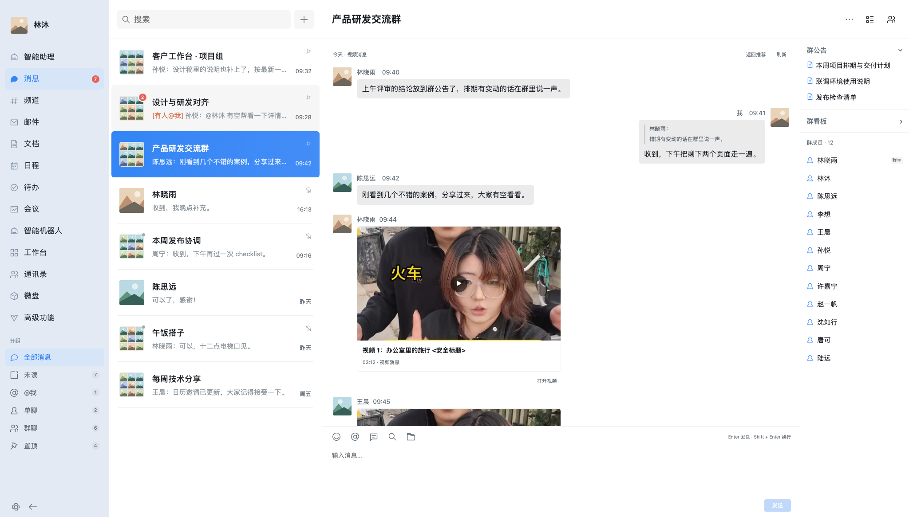

# bilioffice

一个用户脚本，把 B 站推荐、搜索和普通视频页面整理成办公聊天界面。企业微信（默认）、钉钉、飞书共用一份 TypeScript 核心，主题可以热切换。桌面布局采用应用栏、会话列表和聊天主区，企微宽屏另有群信息栏。

**当前是 0.1.3 开发版，不是完整兼容所有 B 站页面的稳定发布版。** 已通过模拟回归和未登录 Chromium 的真实首页、搜索子域、详情气泡播放检查；边界与证据见 [验证记录](docs/VALIDATION.md)。



## 安装和升级

1. 安装 Tampermonkey 或 Violentmonkey；停用旧 BiliShu，避免两个脚本同时处理页面。
2. 打开 [用户脚本源码](https://github.com/penn0312/bilibiliOffice/raw/refs/heads/main/dist/bilioffice.user.js)，确认脚本管理器安装；也可以新建脚本，粘贴 `dist/bilioffice.user.js` 全文并保存。
3. 刷新 B 站首页、搜索页或普通视频页，左下角“设置”可切换三主题、浅色/深色/跟随系统。
4. 升级时替换脚本内容。设置保存在独立的 `bilioffice.settings` 键，不读取旧 BiliShu 配置。
5. “恢复原版”会停止播放并退出办公界面；若当前是虚拟搜索路由，会载入正确的原站地址。原版右下角的“启用 bilioffice”可以重新开启。

## 可以使用的流程

- 首页首屏读取原站推荐卡片，滚动后接续热门视频并标明来源；热门通过 B 站接口加载；分区只适配有原站视频卡片的列表，科技分区入口会完整导航以等待原站加载，不能适配时显示原版入口。
- 搜索结果显示在同一个主聊天流，保留导航与会话栏。支持 Enter、输入法、清空、重新搜索、综合/播放/日期/弹幕/收藏排序、翻页，标题使用文本节点与 `mark` 高亮。
- 搜索初始页面优先读取原站已加载结果；新关键词、排序和页码使用 B 站接口。接口遇到 HTTP 412、登录或网络限制会明确失败；可点“在原站加载后继续”完整载入目标搜索，再使用办公界面。不会用旧数据或假视频填充新结果。
- 点击封面或播放按钮，在该气泡内加载真实 B 站视频页的原生播放器，不先打开详情弹窗。分 P 参数随 URL 保留。
- 直接使用 B 站原生进度条：将鼠标移入视频后拖动，暂停、音量和定位由原生播放器处理，不额外显示独立进度控件。
- 放大、还原、Esc、遮罩只改变布局，iframe 不搬移、不重建；保留原生暂停、进度、音量及播放器支持的全屏。切视频、关闭、刷新和切页会清理上一会话。
- 隐藏媒体直接销毁播放 iframe，也处理仍在加载的 iframe；恢复显示需要手动点击播放。封面使用独立的 16:9 规则与图片失败占位。
- 读取原生评论宿主内的 DOM 和开放 Shadow DOM，显示已加载主评论、楼中楼和图片；“加载更多”调用原站可识别的加载控件并等待真实变化。“导出已加载”包含楼中楼及图片地址，明确不是全量评论。
- 评论区域独立更新，不改动播放节点。评论图片预览支持关闭、Esc，重复打开会先释放旧弹窗监听器。
- 收藏、关注和真实评论发布明确回到原版。本项目没有模拟发送成功，不自动点赞、关注、收藏或发送评论。
- 头像与会话名伪装只改变本地显示，不能隐藏网络访问记录。左侧“视频助手”是本地阅读入口，不是与 B 站用户的真实聊天。

## 权限与运行方式

| 权限 | 用途 |
| --- | --- |
| `@match` 主站、搜索子域、裸域 HTTPS 页面 | 实际只在首页、搜索、普通视频、分区/热门路由启动；直播及其他 iframe 不运行完整壳 |
| `GM_getValue` / `GM_setValue` | 脚本管理器共享设置；无管理器的测试环境才回退本源 localStorage |
| `GM_xmlhttpRequest` + `@connect api.bilibili.com` | 调用 B 站的列表、搜索、详情接口；只请求 JSON，不请求视频流 |
| `document-idle`，允许 iframe 分支 | B 站视频 iframe 只运行受限播放器桥；普通 iframe 不启动界面 |

视频页 iframe 仍是 `www.bilibili.com`，在搜索子域内通过 `postMessage` 协作；两端校验来源、窗口引用、随机会话令牌和消息类型，使用明确 `targetOrigin`。不跨域读取 iframe DOM。不搬移宿主原生播放器，不删除宿主框架节点。脚本激活时暂停主页面后台视频，避免同时出声。

不提取或外传 Cookie、令牌和视频流，不使用第三方解析，不提供下载，也不绕过付费、地区、登录和风控。必要的登录与播放器行为仍由 B 站决定。iframe 沙箱阻止其擅自导航顶层页面；需要原站登录或交互时使用原版入口。

## 开发与验证

Node.js 22，依赖由 `package-lock.json` 锁定。无需后端。

```sh
npm ci
npx playwright install chromium
npm run typecheck
npm run build
npm run check
npm run test:unit
npm test
npm run test:live
```

- `npm test` 是**完全拦截网络的模拟页面回归**，使用真实尺寸封面文件和 Canvas 视频流；不冒充真实 B 站播放。结果见 `docs/mock-results.json`，截图前缀 `mock-`。
- `npm run test:live` 访问真实 B 站，不自动操作任何发布或社交按钮；脚本管理器 HTTP API 使用同一浏览器上下文的请求客户端模拟，尚未安装真实扩展逐一测试。结果见 `docs/live-results.json`，截图前缀 `live-`。

## 架构

- `src/types.ts`：视频、用户、评论、路由、搜索结果和设置共享类型。
- `src/main.ts`：Shell、消息卡片、搜索与独立评论区，按视频 ID 增量同步卡片；主动路由变化才停止播放并刷新。
- `src/core/settings.ts`：独立命名空间、校验、持久化。
- `src/adapters/bilibili.ts`：原站列表采集、接口与 URL 归一化、可取消异步请求。
- `src/adapters/bilibili/comments.ts`：限定评论宿主的 Shadow DOM 读取、等待异步变化、导出。
- `src/player.ts`、`src/player/bridge.ts`：单会话、放大、来源校验、状态与超时、资源释放。
- `src/components/lightbox.ts`：可释放的图片预览。
- `src/themes.ts`、`src/styles/`：主题 tokens、不同导航宽度/密度/头像/气泡布局、明暗与响应式。
- `scripts/build.mjs`：esbuild 生成唯一安装产物 `dist/bilioffice.user.js`。

## 已知限制

- 只验证当前 Chromium 桌面环境；Firefox、Safari、实际脚本管理器扩展、登录后的不同账号和付费内容没有全面实测。
- 活动/番剧等特殊视频可能重定向到 `/festival/` 等非普通视频路径，桥不会在这些页面启动，会显示超时与原版入口；不在首版适配范围内。
- 搜索接口可能被 B 站限制，需完整载入原站结果再继续；新搜索失败不会自动把旧结果标成新结果。主题热切换不刷新，跨主站/搜索域及分区原站加载需导航，播放会停止。
- 评论懒加载、闭合 Shadow DOM、原站控件变更可能导致读取不到评论；不会伪造评论或假成功。真实评论的加载更多、图片及全站分区仍需更广泛验证。
- API 推荐回退使用热门列表，不代表个性化推荐。页面只保留已采集内容，非无限全量数据。

MIT License；来源核对与上游完整声明见 [NOTICE.md](NOTICE.md)。仓库已按用户要求关联并推送；未创建 GitHub Release、标签或部署服务。
